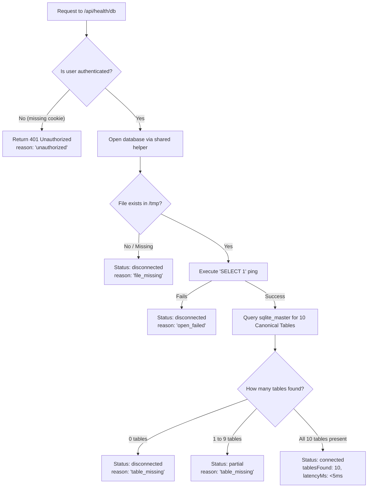

# Data Connection & Database Architecture — Hope, Inc. ERP

This document explains how database connections work in the Hope, Inc. ERP project across both local development and cloud deployment on Vercel. Written for student developers and team members to understand the data lifecycle from the browser to SQLite.

---

## 1. End-to-End Data Path

The diagram below maps how a request travels from a user's web browser down into SQLite database files on disk, contrasting local development with cloud execution on Vercel.

```text
===================================================================================
1. USER BROWSER
   │
   ├─► Navigates to Page (e.g., http://localhost:3000/ or https://...vercel.app/)
   │     │  (Server Component renders on Next.js Server)
   │     ▼
   └─► Client-side Status Check (fetch to /api/health/db)
         │  (Client Component sends cookies automatically)
         ▼
===================================================================================
2. NEXT.JS APP ROUTER (Server Runtime)
   │
   ├── Page Route: src/app/(dashboard)/page.tsx
   │     │ Calls: getHomeSummary() in src/lib/data/home.ts
   │     ▼
   └── API Route: src/app/api/health/db/route.ts
         │ Verifies user: getCurrentUser() in src/app/actions/auth.ts
         │ Calls: checkDatabaseHealth() in src/lib/db-health.ts
         ▼
===================================================================================
3. DATA LAYER & CANONICAL DATABASE HELPER (src/lib/hope-db.ts)
   │
   ├─► Checks Environment: Is process.env.VERCEL defined?
   │     │
   │     ├─► [LOCAL DEVELOPMENT]
   │     │     Path: path.join(process.cwd(), 'hope.db')
   │     │     Directly opens the local hope.db file in project root.
   │     │
   │     └─► [VERCEL SERVERLESS DEPLOYMENT]
   │           Source: path.join(process.cwd(), 'hope.db')  (Read-only Lambda container)
   │           Target: path.join('/tmp', 'hope.db')         (Writable ephemeral RAM-disk)
   │           Lifecycle:
   │             1. Build Time: Next.js bundles hope.db via outputFileTracingIncludes.
   │             2. Cold Start: Shared Promise copies hope.db -> /tmp/hope.db once per instance.
   │             3. Each Request: Reuses existing /tmp/hope.db file.
   │
   ▼
===================================================================================
4. NATIVE SQL ENGINE (node:sqlite DatabaseSync)
   │
   ├─► hope.db  (928 Canonical Records across 10 ERP Tables)
   │     CUSTOMER (82), PRODUCT (57), PRICEHIST (79), EMPLOYEE (32),
   │     JOB (14), DEPARTMENT (8), JOBHISTORY (54), SALES (124),
   │     SALESDETAIL (313), PAYMENT (165)
   │
   └─► auth.db  (User accounts, salted bcrypt hashes, and 36 permissions)
         Initialized in /tmp/auth.db on cold start via ensureAuthDb().
===================================================================================
```

### When Each File is Created or Copied

| Stage | What Happens to `hope.db` | What Happens to `auth.db` |
| :--- | :--- | :--- |
| **Build Time** (`npm run build`) | Next.js traces `hope.db` via `outputFileTracingIncludes` in `next.config.ts` so it is packaged into the serverless bundle. | Not copied. `auth.db` schema is created dynamically at runtime. |
| **Cold Start** (First serverless invocation) | The serverless instance boots. Our shared initialization helper copies `hope.db` from the read-only bundle directory (`process.cwd()`) to `/tmp/hope.db`. | `ensureAuthDb()` runs, creates `USERS`, `RIGHTS`, and `USERRIGHTS` tables in `/tmp/auth.db`, and seeds the default demo accounts. |
| **Each Request** (Subsequent clicks) | Opens `/tmp/hope.db` instantly. Zero copy overhead. | Reads or writes `/tmp/auth.db` directly. |

---

## 2. Why Vercel Serverless Needs Special Handling

Deploying a traditional relational database file like SQLite (`hope.db`) to a serverless platform like Vercel introduces unique architectural constraints that differ from running on your local computer.

### A. The Read-Only Filesystem
In Vercel Serverless Functions (powered by AWS Lambda under the hood), the execution root directory (`process.cwd()`) is **strictly read-only**. 
- SQLite cannot open a database file in default read-write mode inside `process.cwd()`. Doing so triggers an `EROFS: read-only file system` operating system error.
- The **only writable directory** in a serverless function is `/tmp`.
- `/tmp` is a temporary, in-memory mount with up to 512 MB of space. Therefore, `hope.db` must be copied from `process.cwd()/hope.db` to `/tmp/hope.db` before opening.

### B. Cold Starts and Ephemeral Lifecycles
- When no traffic reaches your site for several minutes, Vercel scales serverless functions down to zero instances to conserve resources.
- When a user visits the site again, Vercel initiates a **Cold Start**: spinning up a fresh Node.js container, unpacking the code bundle, and starting the process.
- Any file previously created in `/tmp` disappears when the instance terminates. When a new container boots, `/tmp` starts completely empty again.

### C. Multiple Serverless Instances (Concurrency)
- If multiple users visit the site simultaneously, Vercel spawns multiple parallel Lambda containers.
- Each container has its own private, isolated `/tmp` directory. Container A cannot see or access `/tmp` in Container B.

### D. Why Writes Do Not Persist
- Because `/tmp` is discarded when a container goes to sleep, any inserts or edits made by users on the deployed site will **not persist across redeployments or container restarts**.
- For production ERP systems requiring permanent write persistence across serverless restarts, an external managed database (such as Supabase PostgreSQL) is used. For coursework and demonstration, SQLite in `/tmp` provides a self-contained, lightning-fast sandbox.

---

## 3. How Health Status and Stat Cards Make Decisions

### How `/api/health/db` Decides Status

When a request arrives at `/api/health/db`, `checkDatabaseHealth()` inspects `hope.db` through the following sequence:



1. **Authentication Check:** Requires a valid session cookie (`hope_demo_email` / `hope_demo_role`) or Supabase auth token. Unauthenticated requests receive HTTP 401.
2. **Ping Test:** Runs `SELECT 1 as ping` to verify the SQLite engine can parse queries.
3. **Table Verification:** Checks `sqlite_master` for the presence of all 10 canonical tables (`CUSTOMER`, `PRODUCT`, `PRICEHIST`, `EMPLOYEE`, `JOB`, `DEPARTMENT`, `JOBHISTORY`, `SALES`, `SALESDETAIL`, `PAYMENT`).
4. **Status Classification:**
   - **`connected` (Green):** All 10 tables exist and respond to `COUNT(*)`.
   - **`partial` (Amber):** Between 1 and 9 tables exist.
   - **`disconnected` (Red):** 0 tables exist, or an uncaught file/open error occurred.
   - **`unverified` (Neutral Gray):** Network error or HTTP 401/500 occurred before the check could run.

### How Stat Cards Decide Between a Number and a Dash

Stat cards must **never hide good business data** simply because a client-side health ping failed. The decision rule is decoupled:

- **Shows Real Number (e.g., `₱688,935.47`, `124`, `27`):** When the server-side page render successfully queried the canonical database.
- **Shows Dash (`—`):** Only when the business data query for that specific metric genuinely returned `null` or failed.

---

## 4. Node.js Version Requirements

`node:sqlite` is a built-in module introduced in **Node.js v22.5.0**. It does not exist in Node.js 18 or 20.

If Vercel runs an older Node runtime, attempting to import `node:sqlite` throws:
```text
Error: Cannot find module 'node:sqlite'
```

### Where Node Version is Configured:
1. **`package.json` Engines Field:**
   ```json
   {
     "engines": {
       "node": ">=22.0.0"
     }
   }
   ```
   Vercel reads `package.json` during build time and automatically selects Node.js 22.x.
2. **Vercel Project Dashboard:**
   - Navigate to **Project Settings** → **General**.
   - Under **Node.js Version**, verify it is set to **`22.x`**.

---

## 5. Troubleshooting Guide

| Symptom | Likely Cause | How to Check | Resolution |
| :--- | :--- | :--- | :--- |
| **Status pill is Gray ("Could not verify")** | User is logged out or session cookie expired (HTTP 401). | DevTools → Network → Click `/api/health/db` → Check Status Code. | Log in at `/login`. Status turns green immediately. |
| **Status pill is Red (`file_missing`)** | `hope.db` was not bundled into Vercel Serverless Function. | Run `npm run build` locally, verify `outputFileTracingIncludes` in `next.config.ts`. | Add `outputFileTracingIncludes: { '/**': ['./hope.db', './auth.db'] }` in `next.config.ts`. |
| **Status pill is Red (`open_failed`)** | File permissions or attempt to open `process.cwd()/hope.db` read-write on Vercel. | Check Vercel Function logs for `EROFS: read-only file system`. | Ensure database path uses `/tmp/hope.db` via `getHopeDbPath()`. |
| **Status pill is Red (`timeout`)** | Serverless cold start exceeded timeout threshold. | Check response latency in Network tab. | Ensure cold start timeout allows 8 seconds for initial copy; subsequent checks use 3s. |
| **Status pill is Amber (`table_missing`)** | Partial schema or table migration missing. | Hover status pill to view popover table list. | Re-seed missing tables from `database/HopeDB_audit.sql`. |
| **Stat cards show `—` on fresh load** | Health check status mistakenly coupled to KPI cards. | Check `DashboardKpis.tsx` props. | Decouple KPI cards so they render server-fetched metrics independently. |
