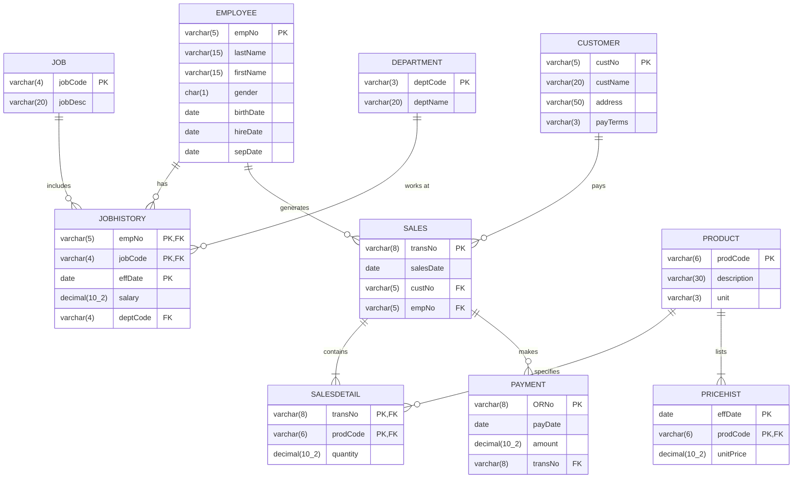

# HOPE, Inc. ERP — Relational Data Model Architecture

> **Architecture Reference Document**  
> **Source Database:** `hope.db` (SQLite 3.x with active Foreign Key enforcement)  
> **Normalization Level:** Third Normal Form (3NF)  
> **Entities:** 10 Tables &bull; 9 Canonical Relationships &bull; 6 Core Business Functions

---

## 1. Executive Summary

This document serves as the canonical reference for the relational architecture of the HOPE, Inc. Enterprise Resource Planning (ERP) platform. The operational business schema is maintained in `hope.db` across 10 tables structured in Third Normal Form (3NF), ensuring zero redundant data storage. Sales invoice totals, line item balances, and active employment statuses are evaluated dynamically at query time using temporal pricing and separation date rules.

The system is organized into five functional table groups:
- **Human Resources (violet):** `EMPLOYEE`, `JOBHISTORY`, `JOB`, `DEPARTMENT`
- **Sales (blue):** `SALES`, `SALESDETAIL`
- **Customer (teal):** `CUSTOMER`
- **Products (amber):** `PRODUCT`, `PRICEHIST`
- **Payments (green):** `PAYMENT`

---

## 2. Mermaid Entity-Relationship Diagram (ERD)

The diagram below mirrors the layout, keys, and cardinalities of the canonical HOPE, Inc. ERD.



---

## 3. Table-to-Pages Matrix

The matrix below maps each table to the application pages, routes, and query functions that read or write its data, along with Third Normal Form (3NF) operational notes.

| Table | Module Group | Live Rows | Primary Key | Key Web Pages & Routes | Operation Modes | Plain-English Role & Operational Notes |
| :--- | :--- | :---: | :--- | :--- | :---: | :--- |
| **`EMPLOYEE`** | Human Resources | 32 | `empNo` | `/employees`, `/employees/[empNo]`, `/sales`, `/`, `/reports` | Read / Write | Lists all company staff, whether they still work here, and which staff member handled each sale. Active status is evaluated as `sepDate IS NULL`. |
| **`JOB`** | Human Resources | 14 | `jobCode` | `/employees`, Job Modals, `/reports` | Read / Write | The list of job titles staff can be given (e.g. `ACCT`, `ENGR`, `SLSREP`). |
| **`DEPARTMENT`** | Human Resources | 8 | `deptCode` | `/employees`, Department Modals, `/reports` | Read / Write | The list of departments where staff work (e.g. `ADM`, `FIN`, `SLS`). |
| **`JOBHISTORY`** | Human Resources | 54 | `(empNo, jobCode, effDate)` | `/employees`, `/employees/[empNo]`, `/reports` | Read / Write | Keeps each employee's work record over time: jobs held, salary and department. Multi-column composite primary key. |
| **`SALES`** | Sales | 124 | `transNo` | `/sales`, `/sales/new`, `/sales/[transNo]`, `/customers`, `/`, `/reports` | Read / Write | One entry per sale: who bought, which staff member sold it, and when. |
| **`SALESDETAIL`** | Sales | 313 | `(transNo, prodCode)` | `/sales/[transNo]`, `/reports`, `/` | Read / Write | The items and quantities listed on each sale. Composite primary key lines recording item quantity. **Total line amounts are not stored**; they are calculated dynamically. |
| **`PRODUCT`** | Products | 57 | `prodCode` | `/products`, `/products/[prodCode]`, `/sales`, `/`, `/reports` | Read / Write | The catalog of computer parts the company sells. Descriptions and packaging units (`pc`, `ea`, `mtr`, `pkg`, `ltr`). |
| **`PRICEHIST`** | Products | 79 | `(effDate, prodCode)` | `/products`, `/sales`, `/`, `/reports` | Read / Write | Each product's price over time, so old sales keep the price they were sold at. Dynamic price resolution selects latest `unitPrice` where `effDate <= salesDate`. |
| **`PAYMENT`** | Payments | 165 | `ORNo` | `/payments`, `/payments/[orNo]`, `/receipts/[orNo]`, `/` | Read / Write | Money received from customers, with an official receipt for each payment, matched to the sale it pays for. Sales can receive 0, 1, or multiple installment receipts. (Not read by Reports). |
| **`CUSTOMER`** | Customer | 82 | `custNo` | `/customers`, `/customers/[custNo]`, `/sales`, `/`, `/reports` | Read / Write | The list of customers with their addresses and how long they have to pay (`COD`, `30D`, `45D`). Mapped via column `payterm` / `payTerms`. |

---

## 4. Canonical 3NF Dynamic Pricing Rule

To guarantee strict compliance with Boyce-Codd & Third Normal Form, neither `SALES` nor `SALESDETAIL` stores pre-calculated totals or unit price snapshots. Instead, queries utilize temporal price matching:

```sql
SELECT 
    sd.transNo,
    sd.prodCode,
    sd.quantity,
    (
        SELECT ph.unitPrice 
        FROM PRICEHIST ph 
        WHERE ph.prodCode = sd.prodCode AND ph.effDate <= s.salesDate 
        ORDER BY ph.effDate DESC LIMIT 1
    ) AS unitPrice,
    sd.quantity * (
        SELECT ph.unitPrice 
        FROM PRICEHIST ph 
        WHERE ph.prodCode = sd.prodCode AND ph.effDate <= s.salesDate 
        ORDER BY ph.effDate DESC LIMIT 1
    ) AS lineTotal
FROM SALESDETAIL sd
JOIN SALES s ON s.transNo = sd.transNo;
```

---

## 5. Report & Home Stat Query Boundaries (Verification Evidence)

### 5.1 Executive Reports Table Scope (7 Canonical Reports)
An exhaustive code inspection of `src/lib/data/reports.ts` and `src/app/actions/reports.ts` reveals the exact table queries:
1. **Top Customers (4 tables):** `CUSTOMER`, `SALES`, `SALESDETAIL`, `PRICEHIST` (`getTopCustomers()`).
2. **Product Master List (2 tables):** `PRODUCT`, `PRICEHIST` (`getProductMasterList()`).
3. **Top Products (4 tables):** `PRODUCT`, `SALESDETAIL`, `SALES`, `PRICEHIST` (`getTopProducts()`).
4. **Active Employees (1 table):** `EMPLOYEE` where `sepDate IS NULL` (`getActiveEmployees()`).
5. **All Employees Report (1 table):** `EMPLOYEE` (`getAllEmployeesReport()`).
6. **Employee Job History (4 tables):** `JOBHISTORY`, `JOB`, `DEPARTMENT`, `EMPLOYEE` (`getEmployeeJobHistoryReport()`).
7. **Top Sales (5 tables):** `SALES`, `CUSTOMER`, `EMPLOYEE`, `SALESDETAIL`, `PRICEHIST` (`getTopSales()`).

> [!IMPORTANT]
> **Crucial Finding:** Across all 7 executive reports, the `PAYMENT` table is **NEVER** queried. Total sales metrics in reports reflect billed invoice totals (`quantity * effectivePrice`), not collections.

### 5.2 Home Stat Cards vs. Database Health Check
- **4 Home Stat Cards (7 Tables Total):**
  - **Total Sales (4 tables):** `SALES`, `SALESDETAIL`, `PRODUCT`, `PRICEHIST` (computed dynamically as `quantity` from `SALESDETAIL` multiplied by scheduled `unitPrice` from `PRICEHIST` on the sale date in `SALES`, linked to item description in `PRODUCT`).
  - **Total Transactions & Customer Accounts (2 tables):** `SALES` (counts 124 completed sales orders) and `CUSTOMER` (provides the 82 customer accounts).
  - **Total Payments (1 table):** `PAYMENT` (sums 165 official payment receipts totaling ₱665,326.58).
  - **Active Employees (1 table):** `EMPLOYEE` (counts current staff where `sepDate IS NULL`, showing 27 active of 32 total staff).
  - *Combined Scope:* Touches strictly 7 tables (`SALES`, `SALESDETAIL`, `PRODUCT`, `PRICEHIST`, `CUSTOMER`, `EMPLOYEE`, `PAYMENT`). Every one of these 7 tables correctly displays `/` (Home) in its navigation chips.
- **Health Check (`/api/health/db`):**
  - Performs a separate complete 10-table scan for integrity and live row counts. This is an administrative monitoring probe, separate from the 4 business KPI cards.

### 5.3 Verified 9 Relationships (Plain English)
1. **`EMPLOYEE has JOBHISTORY`:** One employee can have many job history records over time.
2. **`JOB includes JOBHISTORY`:** One job title can be held by many employees.
3. **`DEPARTMENT works at JOBHISTORY`:** One department can have many employee assignments over time.
4. **`EMPLOYEE generates SALES`:** One staff member can make many customer sales.
5. **`CUSTOMER pays SALES`:** One customer can have many sales.
6. **`SALES contains SALESDETAIL`:** One sale can contain many items.
7. **`PRODUCT specifies SALESDETAIL`:** One product can be ordered in many sales.
8. **`SALES makes PAYMENT`:** One sale can receive many payments.
9. **`PRODUCT lists PRICEHIST`:** One product can have many scheduled prices over time.

